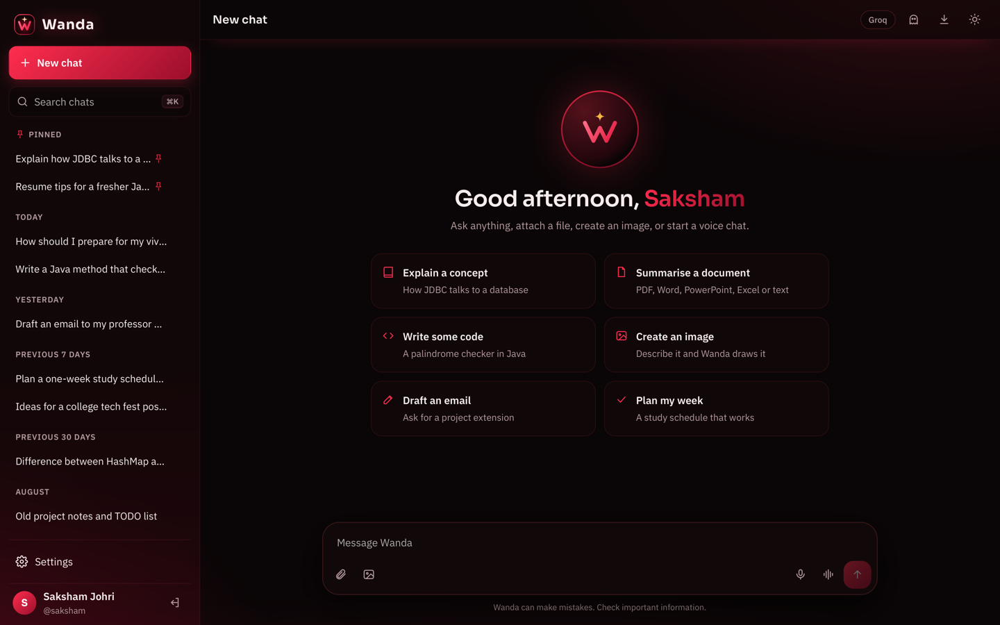
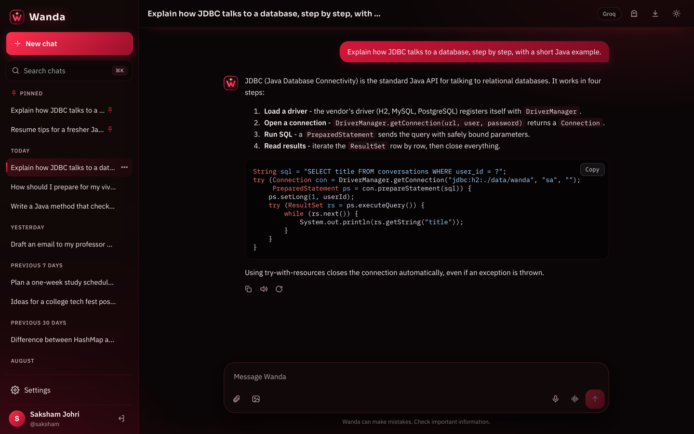
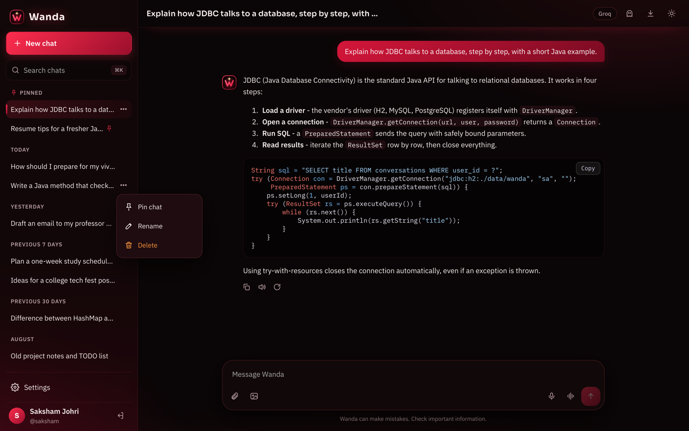
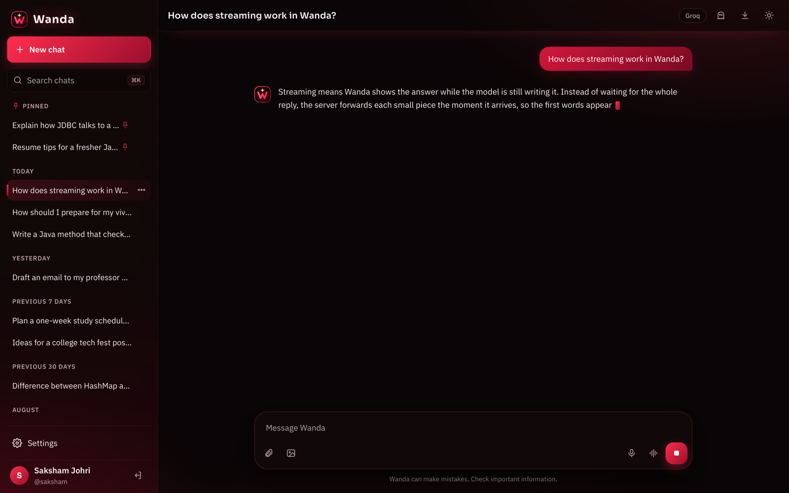
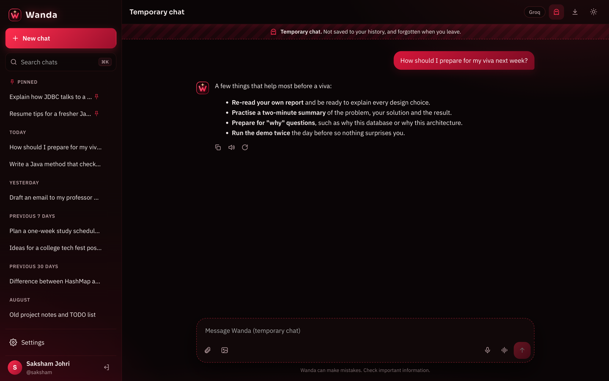

<<<<<<< HEAD
# Wanda AI Assistant

A full-stack AI assistant built in Java with Servlets and JDBC, with a dark scarlet-and-burgundy look inspired by Wanda Maximoff. Wanda streams answers word by word through a free Groq API key, reads the documents and pictures you upload, creates images, talks with you by voice (optional), and keeps your chats in a database under your own account, with pinned chats and a temporary incognito mode.

Developed by **Saksham Johri**.



---

## 1. Overview

Wanda is a lightweight, self-hosted assistant in the spirit of ChatGPT. It runs as a single Java application with an embedded web server and an embedded SQL database, so it starts with one command and needs no external service apart from the free AI keys.

The project shows how core Java concepts (object-oriented design, collections and generics, multithreading, exception handling) come together with JDBC database access and Servlet-based web integration in a complete, usable product.

## 2. Features

| Feature | What it does |
|---|---|
| Streaming chat | Replies appear word by word on a free Groq model (the Stop button keeps whatever was already written). Markdown, tables and code with copy buttons are rendered as they arrive. |
| History like ChatGPT | Every chat is saved. The sidebar groups them as **Pinned, Today, Yesterday, Previous 7 days, Previous 30 days** and by month. Search, rename, pin and delete from each chat's ⋯ menu. |
| Pinned chats | Pin favourite chats to the top; they stay there however many new chats you start. |
| Temporary chat | Incognito mode (ghost button): nothing is saved to the database or to disk, and the chat is forgotten the moment you leave. |
| Image creation | Describe a picture and Wanda draws it with FLUX on Cloudflare Workers AI (free tier). Pictures are saved in the chat and can be downloaded. |
| File understanding | Attach PDF, Word, PowerPoint, Excel, CSV, text or code files, or up to 3 pictures. Text is extracted on the server; pictures are shrunk and sent to a vision model. Follow-up questions keep the context. |
| Voice (optional) | Dictate with the microphone, have replies read aloud, or start a hands-free voice chat: Wanda speaks each sentence while it is still being written. Voice can be switched off completely, or Wanda's voice can be muted so you talk and read the answers. |
| Accounts | Sign up with a username or email and password (salted PBKDF2 hashing). You stay signed in across restarts; sign-in attempts are rate limited. |
| Settings | Display name, System/Light/Dark theme, Groq key, reply style (Fast, Balanced, Deep), model, creativity, custom instructions, voice options, image keys, delete all chats. |
| Responsive UI | Works on desktop and phones, with keyboard shortcuts (Ctrl/Cmd+K to search), drag-and-drop and paste-to-upload. |

| | |
|---|---|
|  |  |
|  |  |

More screenshots are in [docs/screenshots](docs/screenshots): sign in, file summary, voice chat, settings and the mobile layout.

## 3. Quick start

You need **JDK 17 or newer** and **Apache Maven 3.8+** (`java -version`, `mvn -v`).

Download or clone this repository, open a terminal in the project folder and create your settings file:

```bash
cd wanda-ai
cp wanda.properties.example wanda.properties
```

1. Get a **free Groq key** at [console.groq.com/keys](https://console.groq.com/keys). It starts with `gsk_`. (This is Groq, the AI service at groq.com. Keys from xAI's Grok, which start with `xai-`, do not work here.)
2. Open `wanda.properties` and paste it after `GROQ_API_KEY=`.
3. Start Wanda:

```bash
./run.sh            # macOS / Linux: builds on first run, then starts   (Windows: run.bat)
# or
mvn clean package
java -jar target/wanda-ai.jar
```

Open **http://localhost:8080**. The database is created in `./data` on first start.

Without a key the app still runs: Wanda replies with setup instructions, and uploads, themes and history keep working. Each user can also paste their own Groq key in **Settings → Model**.

### Optional: image creation (free)

Image creation uses FLUX on [Cloudflare Workers AI](https://developers.cloudflare.com/workers-ai/). Cloudflare's free plan includes a daily allowance (see their pricing page for the current limit); when it is used up the service returns an error and does not charge you.

1. Create a free account at [dash.cloudflare.com](https://dash.cloudflare.com/sign-up).
2. In the dashboard open **AI → Workers AI**, choose **Use REST API**, and copy your **Account ID**.
3. On the same page click **Create a Workers AI API Token** and copy the token.
4. Paste both into `wanda.properties` (`CLOUDFLARE_ACCOUNT_ID`, `CLOUDFLARE_API_TOKEN`), or into **Settings → Images**.

Then click the picture button next to the message box (or type `/image a red fox in the snow`).

### Configuration

Environment variables with the same names override `wanda.properties`, which is how cloud hosts are configured.

| Setting | Default | Purpose |
|---|---|---|
| `GROQ_API_KEY` | none | Groq key used for every user without their own key |
| `CLOUDFLARE_ACCOUNT_ID`, `CLOUDFLARE_API_TOKEN` | none | Turns on image creation |
| `PORT` | `8080` | HTTP port |
| `DB_URL` | `jdbc:h2:./data/wanda` | JDBC URL of the database |
| `SESSION_DIR` | `data/sessions` | Where sign-in sessions are kept so users stay signed in across restarts |

## 4. Using Wanda

- **New chat / history.** The sidebar lists your chats by date. Hover a chat (or right-click it) and use **⋯** to pin, rename or delete it. **Settings → Data → Delete all chats** clears everything.
- **Temporary chat.** Click the ghost button in the top bar. A banner shows that nothing is saved. The conversation lives only in server memory for that chat, is discarded when you start a new chat, leave, or sign out, and is never written to the database, sessions or disk. Image creation is not available inside a temporary chat, and temporary chats cannot be exported.
- **Voice is optional.** In **Settings → Voice**, *Voice features* hides the microphone, voice-chat and read-aloud buttons for a text-only Wanda. *Wanda speaks in voice chat* can be turned off to talk while reading the answers on screen (there is also a mute button inside the voice chat), and *Read every reply aloud* controls automatic read-aloud in normal chats. Voice needs Chrome, Edge or Safari, an internet connection and microphone permission.
- **Reply style.** *Fast* (default) answers quickly; *Balanced* and *Deep* let the model think longer, which helps with maths and code.
- **Keyboard.** `Enter` sends, `Shift+Enter` adds a line, `Ctrl/Cmd+K` searches chats, `Esc` ends voice chat.

## 5. Technology stack

| Layer | Technology |
|---|---|
| Language | Java 17 |
| Web | Jakarta Servlets 5 on embedded Eclipse Jetty 11 (file-backed sessions, security headers) |
| Database | H2 (file mode) accessed only through JDBC |
| AI chat | Groq chat-completions API (OpenAI-compatible, streamed with server-sent events) via `java.net.http.HttpClient` |
| Images | FLUX.1 schnell on Cloudflare Workers AI |
| Sign-in | Username or email and password, hashed with PBKDF2; sessions kept on the server |
| Parsing | Gson (JSON), Apache PDFBox (PDF); Word, PowerPoint and Excel read directly from their XML; `javax.imageio` for picture resizing |
| Voice | Web Speech API in the browser (speech recognition and speech synthesis) |
| Front end | HTML, CSS and vanilla JavaScript; marked, DOMPurify and highlight.js from a CDN |
| Tests | JUnit 5 (58 unit tests) and a GitHub Actions workflow |
| Build | Maven, packaged as one runnable JAR |

## 6. Architecture and project structure

The code follows a layered design: servlets handle HTTP, services hold the business rules, DAOs perform JDBC operations, and models carry the data.

```
Browser (HTML/CSS/JS, Web Speech API)
      |  JSON over HTTP, streamed replies as newline-delimited JSON
Servlets  (web)        AuthServlet, ChatServlet, ChatStreamServlet, TempChatServlet, ConversationServlet,
      |                ImageServlet, UploadServlet, SettingsServlet, StaticServlet
Services  (service)    AuthService, ChatService, SettingsService, FileService,
      |                ImageService, UploadStore, TempChatStore, RateLimiter
DAOs      (db)         AI providers (ai): ChatCompletionsProvider -> GroqProvider, SetupGuideProvider,
      |                                   ImageProvider -> CloudflareImageProvider
      |  JDBC
H2 database  (users, conversations, messages, settings)
```

```
wanda-ai/
├── pom.xml
├── run.sh / run.bat              build and start in one step
├── Dockerfile                    container image for cloud hosting
├── wanda.properties.example      template for your keys (copy to wanda.properties)
├── .github/workflows/ci.yml      builds and tests every push
├── docs/screenshots/
└── src/
    ├── main/java/com/saksham/wanda/
    │   ├── App.java                  entry point, wires all layers and starts Jetty
    │   ├── config/AppConfig.java     reads wanda.properties and environment variables
    │   ├── model/                    BaseEntity, User, Conversation, Message, Attachment
    │   ├── db/                       Database, Dao<T>, BaseDao<T>, UserDao, ConversationDao, MessageDao, SettingsDao
    │   ├── ai/                       AIProvider, ChatCompletionsProvider, GroqProvider, SetupGuideProvider,
    │   │                             ImageProvider, CloudflareImageProvider, ProviderFactory, ChatRequest
    │   ├── service/                  AuthService, ChatService, SettingsService, FileService,
    │   │                             ImageService, UploadStore, TempChatStore, RateLimiter
    │   ├── exception/                AppException, AuthException, AIException, DataAccessException,
    │   │                             ValidationException, ClientGoneException
    │   └── web/                      BaseServlet, the API servlets, StaticServlet, SecurityHeadersFilter
    ├── main/resources/public/        login.html, index.html, css/, js/, img/
    └── test/java/                    unit tests
```

### How a message travels

1. The browser posts to `/api/chat/stream` and reads the reply as it arrives.
2. `ChatStreamServlet` checks the session, reads the JSON and loads uploads from the `UploadStore`.
3. `ChatService` validates, rate-limits and saves the user message through `MessageDao`.
4. The Groq provider streams tokens back as server-sent events; each piece is forwarded to the browser at once. A watchdog cuts stalled calls.
5. When the reply finishes it is saved. If the user presses **Stop**, the text written so far is kept; if the model fails before writing anything, the user message is rolled back.
6. The browser paints the Markdown as it arrives and, in voice chat, speaks it sentence by sentence.

## 7. Running and deployment

**Run locally**

```bash
./run.sh                       # macOS / Linux: builds on first run, then starts
# or
mvn clean package              # also runs the unit tests
java -jar target/wanda-ai.jar  # any OS
```

If port 8080 is busy, Wanda says so and you can pick another with `PORT=9090 ./run.sh`.

**Deploy online (Render)**

The included `Dockerfile` builds and runs the app on any Docker host.

1. Push this repository to GitHub.
2. On [render.com](https://render.com), choose **New → Web Service**, connect the repository and select the **Docker** runtime.
3. Under **Environment**, add `GROQ_API_KEY` and, optionally, the Cloudflare keys.
4. Click **Create Web Service**. Render sets `PORT` automatically and gives the app a public `https://<name>.onrender.com` address.

On free hosting plans the disk is temporary, so accounts and chats reset when the service restarts. Attach a persistent disk and point `DB_URL` and `SESSION_DIR` at it (for example `jdbc:h2:/var/data/wanda` and `/var/data/sessions`) to keep them.

**Tests**

```bash
mvn test
```

## 8. API reference and database schema

All endpoints exchange JSON and, apart from sign-in, require a signed-in session.

| Method | Endpoint | Purpose |
|---|---|---|
| POST | `/api/auth/register`, `/login`, `/logout` | Create an account, sign in, sign out |
| GET | `/api/auth/me`, `/status` | Current user, whether a session is active |
| POST | `/api/chat/stream` | Send a message (optional `attachmentIds`) or `{"regenerate": true}`; the reply streams back as newline-delimited JSON events `start`, `delta`, `done` or `error`. With `{"temporary": true, "tempId": "..."}` the chat is incognito and nothing is stored |
| POST | `/api/chat` | The same exchange as a single JSON response |
| DELETE | `/api/chat/temp/{tempId}` | Forget a temporary chat right away |
| GET | `/api/conversations` | List chats (pinned first, then newest first) |
| GET / PUT / DELETE | `/api/conversations/{id}` | Read, rename and/or pin (`{"title": "...", "pinned": true}`), or delete a chat |
| DELETE | `/api/conversations` | Delete all chats |
| POST | `/api/image` | Create a picture: `{"conversationId": null, "prompt": "..."}` |
| GET | `/api/image/{messageId}` | The picture of one of your messages |
| POST / DELETE | `/api/upload[/{id}]` | Upload a file (raw body, `X-File-Name` header) or discard it |
| GET / PUT | `/api/settings` | Read or update settings |

| Table | Key columns |
|---|---|
| `users` | id, username (unique), display_name, password_hash, created_at |
| `conversations` | id, user_id → users, title, pinned, created_at, updated_at |
| `messages` | id, conversation_id → conversations, role, content, kind, attachments, context, images, image_count |
| `settings` | (user_id, setting_key) primary key, setting_value |

Foreign keys use `ON DELETE CASCADE`, so deleting a chat removes its messages.

## 9. Java concepts implemented

| Concept | Where it is used |
|---|---|
| Inheritance | `BaseEntity` → `User`, `Conversation`, `Message`; `ChatCompletionsProvider` → `GroqProvider`; `BaseDao<T>` → all DAOs; `BaseServlet` → all API servlets; `AppException` → five exception types |
| Polymorphism | `ProviderFactory` returns a `GroqProvider` or `SetupGuideProvider` as an `AIProvider` depending on the key; `GroqProvider` overrides `endpoint()`, `defaultModel()`, `visionModel()` and `extraParams()`; `BaseServlet` handles every `AppException` subtype through one catch block |
| Interfaces | `AIProvider`, `ImageProvider`, `Dao<T>`, `ChatService.StreamListener` |
| Exception handling | Custom exception hierarchy where each type carries its HTTP status, try-with-resources for every JDBC resource, rollback of the user's message when the model fails, the old answer restored if a regenerate fails, partial replies kept on Stop |
| Collections and generics | `Dao<T>`, `BaseDao<T>`, `RateLimiter<K>`, `Deque`, `ConcurrentHashMap`, `Optional<T>`, generic `readJson(Class<T>)` |
| Multithreading and synchronization | Fixed thread pool with timeouts (`ExecutorService`, `Future`), a `Semaphore` limiting live streams, a scheduled watchdog for stalled streams, synchronized per-user `RateLimiter`, per-chat locks for temporary chats, thread-safe singleton `Database` |
| JDBC | `DriverManager`, `PreparedStatement` with bound parameters, generated keys, `MERGE` upserts, schema creation and upgrade |
| Servlets | Nine servlets mapped in `App.java`, file-backed sessions, JSON and streamed responses, a security-headers filter, static file serving with access control |

## 10. Privacy and security notes

- Passwords are stored as salted PBKDF2-HMAC-SHA256 hashes. Sign-in and sign-up attempts are rate limited, and the session cookie is `HttpOnly`, `SameSite=Lax` and uniquely named.
- API keys saved in Settings are stored in the database and never sent back to the browser.
- Temporary chats are never written to the database, sessions or disk (see section 4). The model provider still receives the messages in order to answer, as with any chat.
- Keep `wanda.properties` out of version control (it is already in `.gitignore`). If you upload files to GitHub through the web page instead of using git, leave the key fields empty.

---

**Author:** Saksham Johri
=======
# wanda-ai
AI-powered chatbot built with Java, Spring Boot, and Groq API, featuring an interactive chat experience and extensible architecture.
>>>>>>> 865992f4d304de7f0e283e7ee34e010e315e2675
